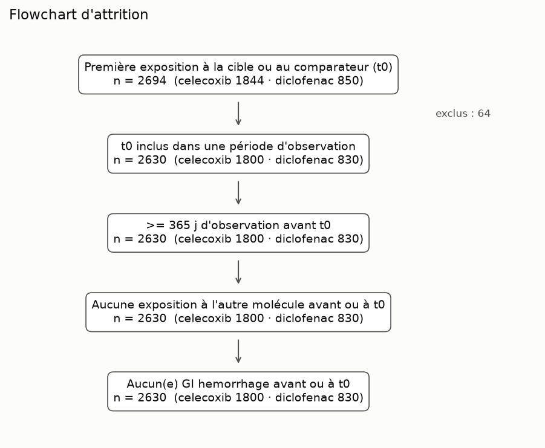
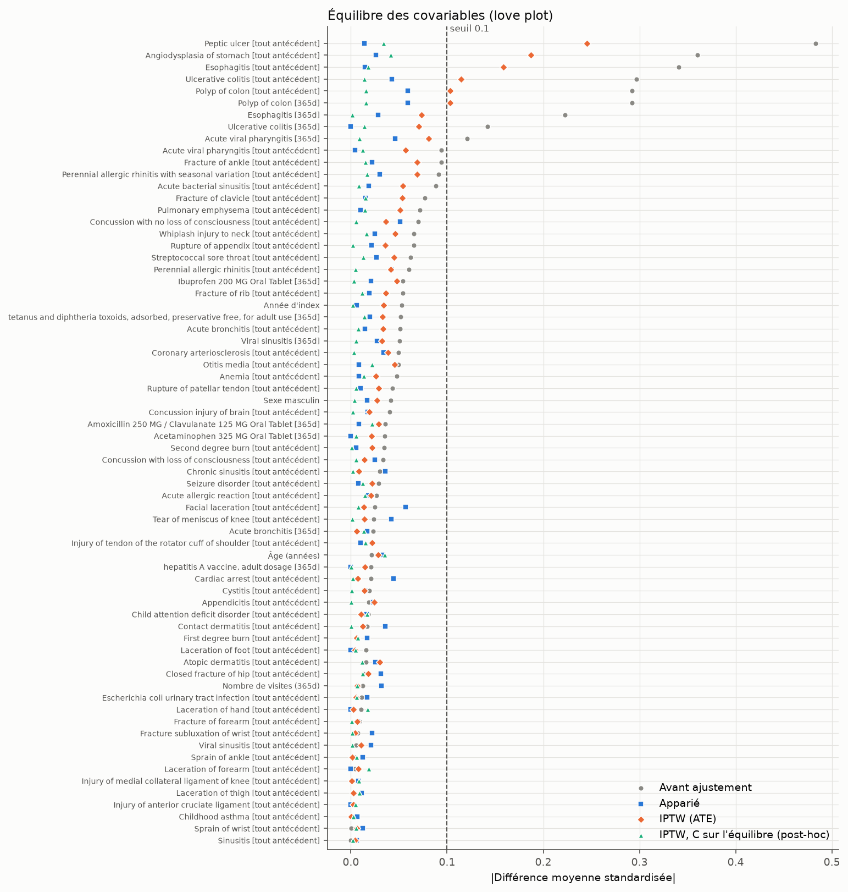
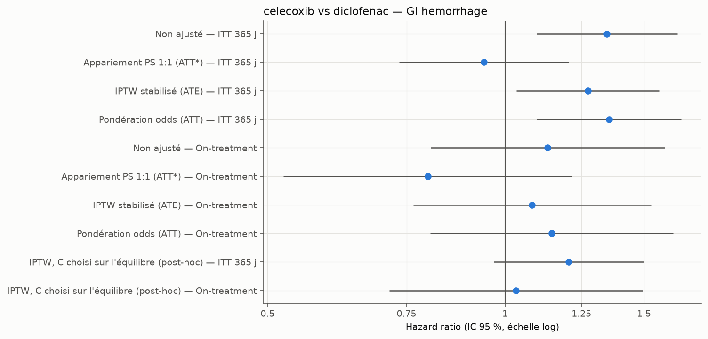
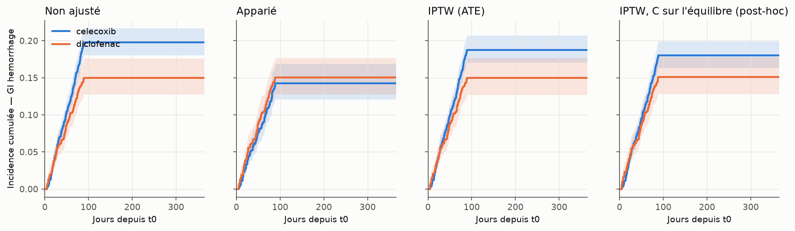

# omop-causal-demo

> **Avertissement.** Toutes les données de ce dépôt sont **synthétiques** (Eunomia GiBleed, Synthea, PMSI factice).
> Aucun résultat n'a de portée clinique. Ce projet est un exercice de méthode, pas une expérience hospitalière réelle.

**Ce que montre ce dépôt.**

- Une chaîne OMOP complète et reproductible : ETL Synthea → CDM 5.4, contrôle qualité OHDSI, étude
  par émulation d'essai cible, contre-vérification avec CohortMethod.
- Le DQD ne suffit pas : il passe à côté d'un défaut de regroupement des visites qui laisse
  jusqu'à 17,3 % des événements sans visite, parce que `visit_occurrence_id` est facultatif. Il
  faut des contrôles propres à l'ETL.
- PMSI → OMOP : dans Athena, seuls 15,4 % des codes CIM10 à 6 caractères (extensions françaises)
  ont un « Maps to ». C'est le premier obstacle d'un ETL PMSI.
- Des résultats rapportés tels quels, y compris quand l'analyse pré-spécifiée échoue
  (déséquilibre IPTW), avec les corrections post-hoc séparées et déclarées.

Démonstration de bout en bout sur le modèle commun **OMOP-CDM** :

1. **ETL** de données de santé vers OMOP-CDM 5.4 (Synthea → PostgreSQL).
2. **Contrôle qualité** avec l'OHDSI Data Quality Dashboard.
3. **Étude observationnelle** (émulation d'essai cible, score de propension, contrôles négatifs,
   E-value), contre-vérifiée avec le package OHDSI CohortMethod.
4. *(Bonus)* mini-ETL d'une table **factice** de type PMSI (CIM-10) vers OMOP.

## En bref

| Phase | Ce qui est fait | Résultat principal |
|---|---|---|
| A1 | Base Eunomia GiBleed en DuckDB, commande `describe` | 2 694 personnes ; 2 649 `person_id` orphelins détectés dans `observation_period` |
| A2 | Celecoxib vs diclofenac → hémorragie digestive (2 630 nouveaux utilisateurs) | HR pré-spécifié (IPTW) 1,273 [1,034 ; 1,568], mais équilibre non atteint ; une fois l'équilibre atteint : 1,205 (IPTW post-hoc) et 0,940 (appariement), IC contenant 1 |
| B | ETL Synthea 3.3.0 → OMOP 5.4 sur PostgreSQL (1 000 patients) | Critères d'acceptation remplis ; défaut de regroupement des visites mis en évidence (jusqu'à 17,3 % d'événements sans visite) |
| C | OHDSI Data Quality Dashboard | 2 338 checks, 18 en échec, chacun expliqué (ETL, Synthea ou règle non pertinente) |
| D | Contre-vérification avec CohortMethod sur la même cohorte | HR non ajusté identique ; HR ajustés à 2–6 % du Python |
| 5 | RUM PMSI fictifs → OMOP, CIM-10 mappée par « Maps to » | 94,1 % des codes mappés (repli sur le parent compris) ; seuls 15,4 % des codes CIM10 à 6 caractères ont un « Maps to » dans Athena |

## Prérequis

- Python ≥ 3.11 et [`uv`](https://docs.astral.sh/uv/)
- R ≥ 4.3 et `renv` (`Rscript -e 'renv::restore()'`). Sous Ubuntu, `.Rprofile` pointe vers les
  binaires de Posit Package Manager : aucun compilateur requis.
- Java JDK (Synthea, `DatabaseConnector`)
- Docker (PostgreSQL) et le client `psql` (chargement rapide des vocabulaires, phase 5)
- Phases B, C et 5 : vocabulaires OMOP téléchargés manuellement depuis
  [Athena](https://athena.ohdsi.org) (compte gratuit), décompressés dans `data/vocab/`

Espace disque mesuré : 4,6 Go pour les vocabulaires décompressés et 760 Mo pour Synthea, plus la
base PostgreSQL.

Environnement de développement : Linux (WSL2), R 4.5, OpenJDK 25, PostgreSQL 16 sous Docker.
Les commandes ci-dessous sont en bash, à lancer depuis la racine du dépôt.

## Démarrage rapide

```bash
uv sync                      # environnement Python
cp .env.example .env         # puis renseigner les secrets
uv run omop-causal --help
```

Qualité du code (exécutée par la CI GitHub Actions à chaque push) :

```bash
uv run ruff check . && uv run ruff format --check . && uv run mypy && uv run pytest
```

## Structure

```
config/study.yaml     protocole de l'étude A2
src/omop_causal/      package Python : cohortes, covariables, PS, équilibre, Cox, rapport, DQD
sql/                  requêtes (cohortes, covariables, diagnostics ETL, investigation DQD)
r/                    scripts R : Eunomia, ETL Synthea, DQD, CohortMethod
pmsi_demo/            générateur de RUM fictifs et ETL SQL vers OMOP
scripts/              génération Synthea, phase 5
docs/                 correspondance ETL et analyse des échecs DQD
tests/                tests unitaires (dont une base OMOP jouet)
```

Aucune donnée n'est versionnée : `data/` et `output/` sont produits par les commandes ci-dessous.

## Phases : commandes et résultats

### Phase A1 — description de la base GiBleed

```bash
Rscript r/01_eunomia_to_duckdb.R        # télécharge GiBleed (CDM 5.3) -> data/gibleed.duckdb
uv run omop-causal describe             # -> output/describe/
```

GiBleed n'est publié qu'en CDM 5.3 et 5.5 ; la version 5.3 est retenue (format supporté par
CohortMethod, phase D). Le vocabulaire embarqué est un extrait (444 concepts).

Effectifs (source : `output/describe/table_counts.csv`) :

| Table | Lignes |
|---|---:|
| person | 2 694 |
| observation_period | 5 343 |
| visit_occurrence | 1 037 |
| condition_occurrence | 65 332 |
| drug_exposure | 67 707 |
| procedure_occurrence | 37 409 |
| measurement | 44 053 |
| concept | 444 |
| concept_ancestor | 65 690 |

Période d'observation (source : `output/describe/observation_summary.csv`) : du 1908-09-22 au
2019-07-03 ; durée médiane d'observation par personne 20 870,5 jours (Q1–Q3 : 17 493,75–24 701,25).

**Anomalie d'intégrité relevée** : 2 649 `person_id` de `observation_period` n'existent pas dans
`person` (et n'ont aucun événement). Les statistiques ci-dessus sont restreintes aux 2 694 personnes
de `person` ; les cohortes de la phase A2 partent de `person`.

Top conditions (personnes distinctes, `output/describe/top20_conditions.csv`) : Osteoarthritis
(2 694), Viral sinusitis (2 686), Acute viral pharyngitis (2 606), Acute bronchitis (2 543),
Otitis media (2 025). Le top 20 des médicaments est dans `output/describe/top20_drugs.csv`.

### Phase A2 — étude observationnelle

```bash
uv run omop-causal study --config config/study.yaml   # -> output/report/
```

**Question** : chez les nouveaux utilisateurs, l'initiation du celecoxib est-elle associée à un
risque d'hémorragie digestive différent de celle du diclofenac ? *(Jeu GiBleed simulé :
exercice de méthode, aucune portée clinique.)*

#### Protocole d'essai cible émulé (paramètres dans `config/study.yaml`)

| Élément | Spécification |
|---|---|
| Éligibilité | Première exposition (new user) à celecoxib ou diclofenac ; t0 dans une période d'observation avec ≥ 365 j d'observation avant ; pas d'hémorragie digestive avant ou à t0 (tout l'historique) ; pas d'exposition à l'autre molécule avant ou à t0 |
| Stratégies | Initier celecoxib vs initier diclofenac |
| Assignation | Non randomisée → ajustement par score de propension |
| Index (t0) | Date de première délivrance ; éligibilité, assignation et début du suivi alignés à t0 (pas de temps immortel) |
| Critère | Première hémorragie digestive strictement après t0 (concept résolu + descendants) |
| Suivi | Principal : ITT 365 j, censure en fin d'observation. Sensibilité « on-treatment » : fin de l'ère d'exposition (`drug_era`) + 30 j, censure la veille d'une initiation de l'autre molécule |
| Covariables | Âge, sexe, année d'index, nb de visites, conditions et médicaments dans [t0-365, t0-1], **conditions à tout moment avant t0** (ajout justifié ci-dessous), indicateurs retenus si prévalence ≥ 1 % |
| Score de propension | Logistique L2 sur covariables standardisées, C par validation croisée 5 plis (log-loss) |
| Estimands | ATT (appariement 1:1 sur le logit du PS, caliper 0,2 SD, sans remise ; et pondération odds) et ATE (poids IPTW stabilisés, troncature 1/99) |
| Analyse | Cox, IC robustes (sandwich ; groupés par paire pour l'apparié) ; KM ; test de Schoenfeld ; pas de Cox si < 10 événements dans un bras |
| Analyse principale | IPTW (ATE), ITT — pré-spécifiée avant tout résultat |
| Sensibilité | E-value (VanderWeele & Ding), contrôles négatifs, variation du caliper et de la troncature |

**Écarts au protocole initial, décidés avant tout résultat** :

- *Fenêtre « tout antécédent » pour les conditions.* Dans GiBleed, les facteurs de risque
  d'hémorragie (ulcère peptique, angiodysplasie, colite ulcéreuse…) surviennent surtout plus de
  365 j avant t0 : une fenêtre de 365 j seule ne les capterait pas.
- *Fichiers SQL.* Cible et comparateur partagent une requête paramétrée
  (`sql/cohorts/new_users.sql`) au lieu de deux fichiers dupliqués.

Particularités des données constatées : toutes les expositions durent 0 jour
(`days_supply = 0`, ères de 0 jour), donc l'analyse « on-treatment » revient à une fenêtre de
30 j après t0 ; le celecoxib (1 800) est plus fréquent que le diclofenac (830), donc un
appariement 1:1 sans remise ne peut pas apparier tous les traités.

#### Résultats

Toutes les valeurs ci-dessous viennent de `output/report/` (`report.md`, `summary.json`, CSV).
Figures : `output/report/figures/` (attrition, score de préférence, love plot, KM, forest plots).
Les quatre principales sont copiées dans `docs/figures/` pour être visibles ici.

**Concepts** (résolus par requête, `concepts.csv`) : celecoxib 1118084, diclofenac 1124300,
hémorragie digestive 192671. Ils correspondent aux valeurs indicatives ; le vocabulaire extrait de
GiBleed ne leur connaît aucun descendant, et les expositions sont codées directement à
l'ingrédient.

**Attrition** (`attrition.csv`) : 2 694 personnes exposées → 2 630 éligibles (celecoxib 1 800,
diclofenac 830). Seul le critère « t0 dans une période d'observation » exclut (64 personnes) ;
aucune hémorragie antérieure ni exposition croisée dans ces données simulées.

**Score de propension** : 68 covariables ; C retenu par validation croisée = 0,001 ; AUC 0,662 ;
827 paires appariées sur 1 800 traités.



**Équilibre** (`balance_summary.csv`, seuil 0,1) :

| Échantillon | max \|SMD\| | Covariables ≥ 0,1 |
|---|---:|---:|
| Avant ajustement | 0,483 | 9 / 68 |
| Apparié | 0,059 | 0 |
| IPTW (ATE) — pré-spécifié | 0,245 | 6 |
| Pondération odds (ATT) | 0,249 | 4 |
| IPTW, C choisi sur l'équilibre (post-hoc) | 0,041 | 0 |

**Le critère « tous les SMD < 0,1 » n'est pas rempli par les pondérations pré-spécifiées.**
Explication : la validation croisée sur la log-vraisemblance choisit un C très faible (un PS
fortement contracté vers la moyenne, c'est un vrai optimum de prédiction, pas un bug). L'appariement
n'utilise que le rang du logit avec un caliper relatif à son écart-type, il n'en souffre pas ; la
pondération, elle, dépend de la calibration du PS, et les poids restent proches de 1. Les
covariables mal équilibrées sont justement les facteurs de risque d'hémorragie (ulcère peptique
0,245, angiodysplasie gastrique 0,187, œsophagite, colite ulcéreuse, polype colique). La part de
la cohorte « en équipoise » (98,0 %) est elle aussi gonflée par cette contraction du PS.

<details>
<summary>Love plot : |SMD| de chaque covariable avant et après ajustement</summary>



</details>

**Effets — Cox, IC 95 % robustes** (`results.csv`) :

| Analyse | Suivi | Événements celecoxib / diclofenac | HR [IC 95 %] |
|---|---|---|---|
| Non ajusté | ITT 365 j | 355 / 124 | 1,347 [1,097 ; 1,653] |
| Appariement PS 1:1 (ATT\*) | ITT 365 j | 118 / 124 | 0,940 [0,734 ; 1,204] |
| **IPTW (ATE) — analyse principale** | ITT 365 j | 355 / 124 | **1,273 [1,034 ; 1,568]** |
| Pondération odds (ATT) | ITT 365 j | 355 / 124 | 1,354 [1,096 ; 1,673] |
| IPTW, C choisi sur l'équilibre (post-hoc) | ITT 365 j | 355 / 124 | 1,205 [0,968 ; 1,501] |
| Non ajusté | On-treatment | 113 / 46 | 1,132 [0,805 ; 1,593] |
| Appariement PS 1:1 (ATT\*) | On-treatment | 37 / 46 | 0,798 [0,524 ; 1,216] |
| IPTW (ATE) | On-treatment | 113 / 46 | 1,082 [0,765 ; 1,531] |
| Pondération odds (ATT) | On-treatment | 113 / 46 | 1,145 [0,804 ; 1,633] |
| IPTW, C choisi sur l'équilibre (post-hoc) | On-treatment | 113 / 46 | 1,032 [0,713 ; 1,494] |

Tests de Schoenfeld : p entre 0,096 et 0,781 selon l'analyse (`ph_test_p` dans `results.csv`).
\*ATT\* : seuls 827 des 1 800 traités sont appariés (830 témoins), l'estimand est l'effet chez
les traités *appariés* ; la pondération odds estime l'ATT sur tous les traités.





**Lecture.** L'analyse principale pré-spécifiée (HR 1,273) est biaisée par un déséquilibre
résiduel sur les facteurs de risque. Quand l'équilibre est atteint, l'estimation se rapproche de 1 :
1,205 [0,968 ; 1,501] en IPTW post-hoc, 0,940 [0,734 ; 1,204] en appariement. L'écart entre ces
deux derniers peut venir de la différence d'estimand : l'appariement écarte environ 970 traités,
surtout ceux à PS élevé (pic de droite sur la figure du score de préférence). La phase D
retrouve cet écart avec CohortMethod. Il n'y a pas de conclusion clinique à en tirer : les
données sont simulées.

**E-value** de l'analyse principale (`evalue.csv`) : l'incidence cumulée à 365 j vaut 0,183, au-dessus du
seuil « événement rare » de 0,15, donc on utilise l'approximation HR→RR pour événement fréquent (RR ≈ 1,182).
E-value du point : 1,646 ; de la borne de l'IC : 1,178.

**Sensibilité** :
- *Caliper* 0,05 → 0,5 SD : 824 à 828 paires, HR apparié de 0,932 à 0,940
  (`sensitivity_caliper.csv`).
- *Troncature IPTW* sans / 1–99 / 5–95 : HR 1,279 / 1,273 / 1,265, max |SMD| 0,231 / 0,245 /
  0,310 (`sensitivity_truncation.csv`) : la troncature ne corrige pas le déséquilibre.
- *C choisi sur l'équilibre (post-hoc)* : ajouté **après lecture des HR**, en réponse au
  déséquilibre ; la sélection n'utilise que l'équilibre des covariables (étape de design, sans le
  critère). Sur la grille de C, max |SMD| passe de 0,246 (C = 0,001) à 0,041 (C = 1, retenu)
  (`sensitivity_ps_balance_tuned.csv`).
- *Contrôles négatifs* (10 validés, `negative_controls.csv`) : 3 estimables (sinusite virale,
  pharyngite virale, bronchite aiguë), HR de 0,931 à 1,144 selon la méthode, tous les IC
  contiennent 1. Les 7 autres ont moins de 10 événements dans un bras et sont signalés « événements
  insuffisants » plutôt que forcés. Trois contrôles ne suffisent pas pour calibrer
  empiriquement les IC.

### Phase B — ETL Synthea

```bash
bash scripts/generate_synthea.sh          # Synthea v3.3.0, 1 000 patients -> data/synthea/output/csv
docker compose up -d                      # PostgreSQL 16 (identifiants dans .env)
Rscript r/02_synthea_etl_postgres.R       # ETL CDM 5.4 + vérifications -> output/etl/
```

Prérequis : vocabulaires Athena décompressés dans `data/vocab/` (liste dans
[`docs/etl_mapping.md`](docs/etl_mapping.md), qui décrit aussi la correspondance des tables et
les choix de l'ETL).

#### Résultats (sources : `output/etl/`)

Critères d'acceptation (`acceptance.csv`) : tous remplis.

| Vérification | Attendu | Observé |
|---|---|---|
| `person` = patients générés par Synthea | 1 000 | 1 000 |
| `cdm_source` renseignée | ≥ 1 ligne | 1 (CDM 5.4, Synthea 3.3.0, vocabulaire « v5.0 29-AUG-26 ») |
| Vocabulaires : lignes en base = lignes des CSV Athena | 9 tables | 9 / 9 |

Le compte des lignes de toutes les tables est dans `row_counts.csv`. Principales tables
cliniques : `visit_occurrence` 55 636, `condition_occurrence` 15 509, `drug_exposure` 64 797,
`procedure_occurrence` 63 136, `measurement` 527 553, `observation` 265 019, `death` 98.

Durée (`etl.log`) : chargement des vocabulaires 20,3 min (mode `psql`), tables Synthea 2,0 min,
mapping et regroupement des visites 2,1 min, tables d'événements 4,4 min.

Constats (`diagnostics.txt`, détaillés dans [`docs/etl_mapping.md`](docs/etl_mapping.md)) :

- **Défaut de l'ETL sur les visites** : les classes Synthea 3.3.0 `urgentcare`, `virtual`, `snf`,
  `home` et `hospice` (3 445 rencontres) ne sont pas prises en charge par le regroupement des
  visites. Selon la table, 4,5 % (`condition_occurrence`) à 17,3 % (`observation`) des
  événements n'ont pas de `visit_occurrence_id`.
- **Routage par domaine** : 19 274 des 35 095 conditions Synthea sont des *findings* SNOMED
  sociaux ou administratifs, rangés en `observation` comme le prévoit OMOP ; 944 ne sont pas
  mappées.

### Phase C — qualité des données

```bash
Rscript r/03_run_dqd.R            # OHDSI DataQualityDashboard 2.9.1 -> output/dqd/dqd_results.json
uv run omop-causal dqd-summary    # synthèse par catégorie + liste des checks en échec
```

Résultats (`output/dqd/`) : 2 338 checks, **18 en échec**, 0 erreur d'exécution. Analyse
détaillée de chaque échec dans [`docs/dqd_findings.md`](docs/dqd_findings.md), établie à partir
de requêtes sur la base (`sql/dqd/investigate.sql`).

| Catégorie | Échecs | Réussis (hors non applicables) |
|---|---:|---:|
| Conformité | 2 | 832 / 834 |
| Complétude | 7 | 364 / 371 |
| Plausibilité | 9 | 333 / 342 |

Par origine : 4 checks relèvent de l'ETL (type de concept d'observation non standard,
`quantity` à 0, `days_supply` hors bornes), 10 de Synthea (données absentes ou artefacts, dont un
cancer de l'ovaire chez un homme), 3 de règles non pertinentes pour une source simulée, et 1 est
mixte (unités de mesure : 54 462 valeurs numériques sans unité mappée à cause d'une syntaxe UCUM
différente). Le DQD ne voit pas le défaut de regroupement des visites trouvé en phase B, car
`visit_occurrence_id` est facultatif dans le CDM.

### Phase D — contre-vérification avec CohortMethod

```bash
uv run omop-causal study --config config/study.yaml   # écrit aussi output/report/cohort.csv
Rscript r/04_cohortmethod_crosscheck.R                # CohortMethod 6.0.3 -> output/cohortmethod/
```

Le script donne à CohortMethod **la même cohorte éligible** que le Python (mêmes 2 630
personnes, même t0, lus dans `cohort.csv`) et reconstruit le critère par la même règle
(descendants via `CONCEPT_ANCESTOR`, concept_id revérifiés par requête). Il écrit la table de
cohortes dans une copie de la base (`data/gibleed_cm.duckdb`). Les écarts viennent donc de la
méthode, pas de la population : covariables FeatureExtraction par défaut (389, sans les deux
molécules) et PS LASSO avec validation croisée (Cyclops), contre 68 covariables et une logistique
L2 côté Python.

| Analyse (ITT 365 j) | Python HR [IC 95 %] | CohortMethod HR [IC 95 %] | Ratio CM / Python |
|---|---|---|---:|
| Non ajusté | 1,347 [1,097 ; 1,653] | 1,346 [1,101 ; 1,657] | 1,000 |
| Appariement PS 1:1, Cox non stratifié | 0,940 [0,734 ; 1,204] | 0,883 [0,683 ; 1,140] | 0,940 |
| Appariement PS 1:1, Cox stratifié sur la paire | (non fait ; comparé à 0,940) | 0,896 [0,686 ; 1,168] | 0,953 |
| IPTW ATE sans troncature | 1,279 [1,038 ; 1,576] | 1,256 [1,019 ; 1,511] | 0,982 |

Sources : `output/cohortmethod/comparison.csv`, `results.csv`, `summary.csv`,
`balance_summary.csv`. Côté Python, la ligne IPTW sans troncature vient de
`sensitivity_truncation.csv` (l'analyse principale, tronquée à 1–99 %, donne 1,273).

Explication des écarts :

- **Non ajusté** : mêmes effectifs (1 800 / 830) et mêmes événements (355 / 124). Il reste un
  écart de 0,04 %, qui vient des ex æquo : Cyclops utilise la méthode de Breslow, lifelines celle
  d'Efron. L'alignement du suivi (critère strictement après t0, censure à 365 j ou en fin
  d'observation) est donc identique.
- **Score de propension** : CohortMethod garde 16 covariables non nulles sur 389 (AUC 0,631),
  contre une AUC de 0,662 côté Python. Les pondérations IPTW sont stabilisées des deux côtés
  (vérifié dans le code de `CohortMethod:::computeIptw`). Le reste de l'écart IPTW (−1,8 %)
  vient donc du modèle de PS.
- **Appariement** : avec un autre PS, les paires changent (830 contre 827) et les événements chez
  les traités appariés aussi (111 contre 118). D'où un HR plus bas de 6 %, dans l'IC du Python.
- **Intervalles** : bootstrap pour l'IPTW de CohortMethod, variance robuste (sandwich) côté
  Python. Pour l'apparié, profil de vraisemblance côté CM et variance robuste groupée par paire
  côté Python.
- **Équilibre** (max |SMD| après ajustement, sur les 389 covariables de CM) : 0,139 apparié
  (6 covariables ≥ 0,1), 0,100 en IPTW (2 covariables ≥ 0,1). Ces valeurs ne se comparent pas
  directement à celles du Python, qui portent sur 68 covariables.

**Lecture.** CohortMethod confirme la direction et l'ordre de grandeur de chaque estimation.
Il reproduit surtout le résultat le plus important de la phase A2 : l'IPTW (ATE, environ 1,26)
et l'appariement (ATT des traités appariés, environ 0,88–0,94) divergent quelle que soit
l'implémentation. Cet écart ne vient donc pas d'un défaut du code Python ; l'explication la plus
probable est la différence d'estimand (population pondérée contre traités appariés).

### Phase 5 (bonus) — PMSI factice → OMOP

```bash
bash scripts/run_pmsi_demo.sh   # génère data/pmsi/rum_fictif.csv puis exécute l'ETL SQL -> output/pmsi/
```

- `pmsi_demo/generate_fake_rum.py` produit une table **entièrement fictive** (graine fixée,
  colonne `avertissement` sur chaque ligne) qui imite un RUM simplifié du PMSI MCO : séjour
  (`n_rss`), passage en unité (`n_rum`), patient, dates au format `JJMMAAAA`, mode d'entrée et
  provenance, mode de sortie et destination, DP / DR / DAS en CIM-10 **sans point** (`K922`).
  Elle compte 857 RUM, 610 séjours et 400 patients.
- `pmsi_demo/etl_rum_to_omop.sql` (PostgreSQL) alimente un schéma séparé, `pmsi_omop`, à partir
  du vocabulaire Athena chargé en phase B. Le CDM Synthea n'est pas modifié. L'export Athena contient le vocabulaire français **CIM10**,
  mais pas le vocabulaire ICD10 de l'OMS : le mapping passe donc par
  `CONCEPT_RELATIONSHIP` (« Maps to »), sans table de correspondance manuelle.

| PMSI | OMOP |
|---|---|
| Séjour (RSS) | `visit_occurrence` (Inpatient Visit) |
| Passage dans une unité (RUM) | `visit_detail`, rattaché à la visite |
| DP / DR / DAS | `condition_occurrence`, `procedure_occurrence` ou `observation` selon le domaine du concept standard ; statut *Primary diagnosis* (DP) ou *Secondary diagnosis* (DR et DAS, faute d'équivalent du DR) |
| Mode d'entrée / de sortie | `admitted_from` / `discharged_to` (urgences, autre hôpital, SSR, EHPAD) ; décès → `death` |

Choix et limites :

- **Format des codes** : le RUM écrit `K922`, Athena `K92.2`. L'ETL normalise les codes avant la
  jointure.
- **Repli sur le code parent** : quand un code existe dans CIM10 sans « Maps to » (extensions
  françaises comme `E66.00` ou `E11.90`), l'ETL prend le « Maps to » du code parent (`E66.0`,
  `E11.9`) et garde le code d'origine dans `*_source_concept_id`. Le statut `parent` signale ce
  repli, qui fait perdre de la précision.
- **Codes inconnus** : 3 codes inexistants en CIM-10 FR (forme CIM-10-CM américaine, par exemple
  `K80.20`) sont injectés volontairement. Ils sont chargés avec le concept 0 et leur valeur source.
  L'ETL ne les rattache pas à un parent : une erreur de codage ne doit pas être corrigée en silence.
- **Concepts de référence** (type, statut, visite, lieux) : retrouvés par requête
  (`ref_concepts.csv`). « Home » (8536) n'est plus standard dans cet export : les 188 séjours
  venus du domicile sans passer par les urgences ont `admitted_from_concept_id = 0`.
- Le PMSI ne date pas les diagnostics : on leur donne les dates du passage dans l'unité. La période
  d'observation va du premier au dernier jour d'hospitalisation, car le PMSI ne voit rien en
  dehors de l'hôpital.

#### Taux de mapping (`output/pmsi/mapping_rate.csv`)

| Unité | Total | Direct | Via le parent | Code inconnu | Taux strict | Taux avec repli |
|---|---:|---:|---:|---:|---:|---:|
| Codes distincts | 51 | 45 | 3 | 3 | 88,2 % | 94,1 % |
| Occurrences (DP + DR + DAS) | 2 517 | 2 298 | 167 | 52 | 91,3 % | 97,9 % |

Ces taux dépendent de la liste de codes **choisie pour la démonstration** et ne représentent
pas un vrai PMSI. La couverture du vocabulaire entier est plus parlante
(`vocab_coverage.csv`, concepts non pondérés par leur fréquence d'usage) : 38,4 % des 42 886
concepts CIM10 ont un « Maps to ». Le taux est de 99,8 % pour les codes à 3 caractères, 82,4 %
pour ceux de la forme `X99.9`, et seulement 15,4 % et 10,0 % pour les codes à 6 et 7
caractères. Ces derniers regroupent les extensions françaises et les subdivisions de site ou
d'activité. Sur une vraie base, ces extensions sont le premier poste à traiter (repli sur le
parent ou `SOURCE_TO_CONCEPT_MAP` validée par un médecin DIM).

Répartition (`table_counts.csv`) : 2 172 lignes en `condition_occurrence` (dont 52 au concept
0), 81 en `procedure_occurrence` (séances de chimiothérapie et de radiothérapie, `Z51.1` et
`Z51.01`, mappées vers des procédures) et 264 en `observation` (codes Z de contexte, dont 166
avec un `value_as_concept_id` issu de « Maps to value »). On compte aussi 610 visites, 857
détails de visite et 27 décès.

## Limites

- **Données simulées partout** : les résultats valident des méthodes et des pipelines, jamais une
  hypothèse clinique.
- **A2** : l'analyse pré-spécifiée n'atteint pas l'équilibre ; la correction est post-hoc et
  déclarée comme telle. Avec seulement 3 contrôles négatifs estimables, il n'y a pas de
  calibration empirique des IC.
- **B / C** : les défauts de l'ETL OHDSI sont documentés, pas corrigés (liste des correctifs dans
  [`docs/dqd_findings.md`](docs/dqd_findings.md)).
- **5** : la CI ne teste que le générateur. L'ETL SQL demande PostgreSQL et le vocabulaire
  Athena, qui ne peut pas être redistribué.
